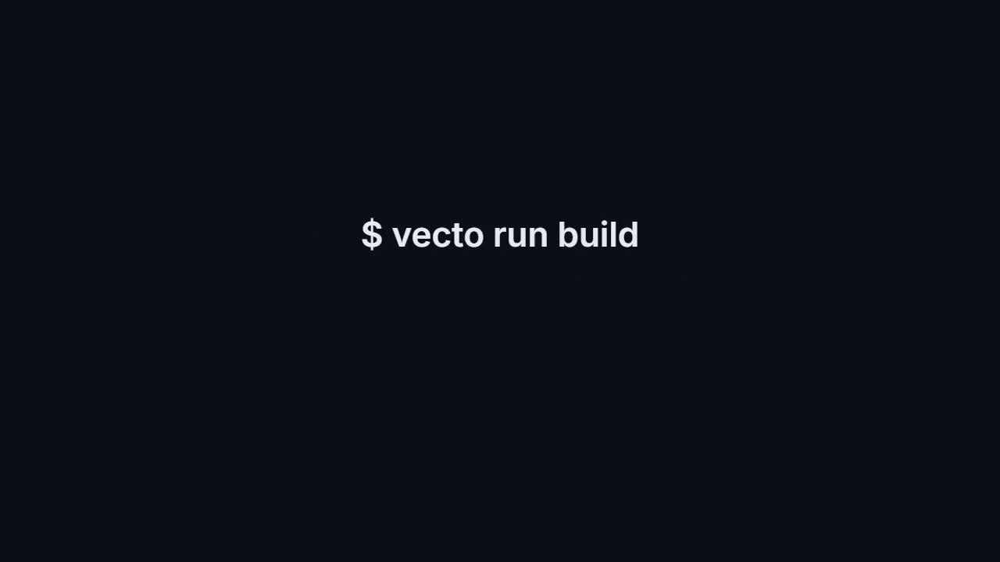

# Vecto

A language-agnostic DAG task runner and content-addressed build cache in Go.

[](https://github.com/Sehaan-1/vecto/actions/workflows/ci.yml)
[](https://sehaan-1.github.io/vecto/)
[](https://goreportcard.com/report/github.com/Sehaan-1/vecto)
[](LICENSE)

## Install

### Quick Install (One-Liner)

**Linux & macOS:**
```bash
curl -fsSL https://raw.githubusercontent.com/Sehaan-1/vecto/master/install.sh | bash
```

**Windows (PowerShell):**
```powershell
irm https://raw.githubusercontent.com/Sehaan-1/vecto/master/install.ps1 | iex
```

### Package Managers & Docker

* **Homebrew:**
  ```bash
  brew install Sehaan-1/vecto/vecto
  ```
* **Scoop (Windows):**
  ```powershell
  scoop install https://raw.githubusercontent.com/Sehaan-1/vecto/master/scoop/vecto.json
  ```
* **Docker:**
  ```bash
  docker run --rm -v "$(pwd):/workspace" -w /workspace ghcr.io/sehaan-1/vecto:latest run build
  ```
* **Go Install:**
  ```bash
  go install github.com/Sehaan-1/vecto/cmd/vecto@latest
  ```
* **Pre-built Binaries:** Download cross-platform archives directly from [GitHub Releases](https://github.com/Sehaan-1/vecto/releases/latest).

## 30 seconds

```bash
vecto init
# writes vecto.yaml with a sample lint → test → build graph

vecto run build
# [-] lint ... running
# [✓] lint (1.80s)
# [-] test ... running
# [✓] test (1.58s)
# [-] build ... running
# [✓] build (1.77s)
#
# --- Summary ---
# Tasks:    3 total (0 cached, 3 executed, 0 failed, 0 skipped)
# Duration: 5.61s

vecto run build
# [⚡ CACHED] lint
# [⚡ CACHED] test
# [⚡ CACHED] build
#
# --- Summary ---
# Tasks:    3 total (3 cached, 0 executed, 0 failed, 0 skipped)
# Duration: 0.38s
# second run restores from cache, no commands re-run

vecto graph --format=mermaid  # or --json for CI
```



## Architecture

```
                           ┌──────────────┐
                           │  vecto.yaml  │
                           └──────┬───────┘
                                  │
                                  ▼
                         ┌─────────────────┐
                         │ internal/config │  (Schema Validation & Typo Diagnostics)
                         └────────┬────────┘
                                  │
                                  ▼
                         ┌─────────────────┐
                         │  internal/dag   │  (Kahn's Min-Heap Topo Sort & Visualizer)
                         └────────┬────────┘
                                  │
         ┌────────────────────────┴────────────────────────┐
         │                                                 │
         ▼                                                 ▼
┌──────────────────┐                              ┌──────────────────┐
│  internal/hash   │                              │  internal/cache  │
│ (SHA-256 + Glob) │                              │ (Atomic & Lock)  │
└────────┬─────────┘                              └────────┬─────────┘
         │                                                 │
         └────────────────────────┬────────────────────────┘
                                  │
                                  ▼
                         ┌─────────────────┐
                         │ internal/runner │  (Event-Driven Dispatch & Tree Teardown)
                         └────────┬────────┘
                                  │
                                  ▼
                         ┌─────────────────┐
                         │   internal/ui   │  (Dashboard, JSON Summary & Slog)
                         └─────────────────┘
```

* Event-driven scheduler, SHA-256 transitive hashing, atomic cache with cross-platform locks — see [ADR-0006](docs/adr/0006-reactive-event-driven-scheduler.md), [ADR-0004](docs/adr/0004-cryptographic-input-hashing.md), [ADR-0008](docs/adr/0008-atomic-cache-staging.md).
* **Merkle File Index (VFI):** incremental input fingerprinting in O(changed files) — a persistent stat-cached Merkle forest under `.vecto/`, glob-coverage digests, git-racy-safe; on by default, `--no-file-index` for the legacy full-scan path — see [ADR-0019](docs/adr/0019-merkle-file-index-incremental-fingerprinting.md) and the 100k-file proof in [`docs/benchmarks.md`](docs/benchmarks.md) §7.

---

## What it does

* Dispatches tasks as dependencies resolve (event-driven, not phase-blocked).
* Content-addressed fingerprints over commands, input files (`**` globs + ignore files), env vars, and upstream hashes.
* Incremental fingerprinting: a Merkle file index (`.vecto/fileindex.json`) re-hashes only what changed — one stat cascade per run, 0 file reads when nothing changed; `vecto index` / `vecto index --rebuild` for introspection, `--no-file-index` to opt out.
* Cache integrity: schema versioning, SHA-256 verification, atomic staging + file locks, optional HTTP remote cache.
* Process-group teardown (`SIGTERM` then `SIGKILL` / `taskkill /F /T`).
* Tooling: `vecto graph`, `--dry-run`, `--` passthrough, `slog` logging, `--json` summary.

## Benchmarks (measured)

| Scenario | Make | Vecto |
|---|---|---|
| Hot replay (7 tasks) | 773 ms | 17.5 ms |
| Topo-sort 10k nodes | — | 2.8 ms |
| 100k-file warm fingerprinting | — | 0.59 s (VFI) vs 5.69 s legacy, 9.6× |

Same-machine Turbo/Just rows and full method in [`docs/benchmarks.md`](docs/benchmarks.md). Hot vs Make flatters any cacher (Make has no cache); the honest cacher-vs-cacher table is in section 6 there.

## Proof

| Claim | Where to check |
|---|---|
| CI green on 3 OSes plus the minimum-Go job | [CI workflow](https://github.com/Sehaan-1/vecto/actions/workflows/ci.yml) |
| Benchmarks with recorded environments | [Bench workflow](https://github.com/Sehaan-1/vecto/actions/workflows/bench.yml) — artifact `bench-results` |
| Every number above, plus its method | [`docs/benchmarks.md`](docs/benchmarks.md) |
| Design decisions and trade-offs | [ADR index](docs/adr/README.md) |

Rerun the suite and regenerate the artifact on your own machine:

```bash
go run ./benchmarks/report -out bench-results
```

The benchmark table above is pinned to the author's machine, with the environment
recorded in `docs/benchmarks.md`; the Bench workflow run is the live, reproducible
artifact.

## Configuration

```yaml
version: "1"
tasks:
  build:
    command: "go build -o bin/app ."
    deps: ["test"]
    inputs: ["**/*.go"]
    outputs: ["bin/app"]
```

Full flag reference and diagnostics (`did you mean ...?`, cycle paths, overlapping inputs) in [`docs/`](docs/) and `vecto --help`.

## License

MIT — see [LICENSE](LICENSE).
